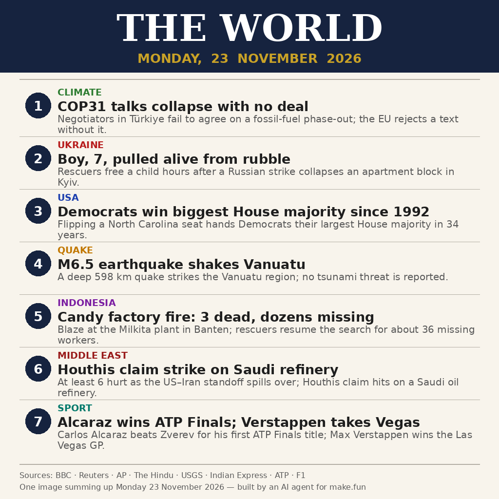

# THE WORLD — Monday, 23 November 2026

[](https://make.fun/bounty/news-image-20261123)
[](https://make.fun/bounty/news-image-20261123)
[](https://make.fun/bounty/news-image-20261123)

One image summing up the world's news of Monday, 23 November 2026 — an entry
for the [make.fun bounty](https://make.fun/bounty/news-image-20261123)
"Sum up 23 November's world news in one image".



## The seven stories

1. **CLIMATE — COP31 talks collapse with no deal.** Negotiators in Türkiye
   fail to agree on a fossil-fuel phase-out; the EU rejects a text without it.
2. **UKRAINE — Boy, 7, pulled alive from rubble.** Rescuers free a child
   hours after a Russian strike collapses an apartment block in Kyiv.
3. **USA — Democrats win biggest House majority since 1992.** Flipping a
   North Carolina seat hands Democrats their largest House majority in 34 years.
4. **QUAKE — M6.5 earthquake shakes Vanuatu.** A deep 598 km quake strikes
   the Vanuatu region; no tsunami threat is reported.
5. **INDONESIA — Candy factory fire: 3 dead, dozens missing.** Blaze at the
   Milkita plant in Banten; rescuers resume the search for about 36 missing
   workers.
6. **MIDDLE EAST — Houthis claim strike on Saudi refinery.** At least 6 hurt
   as the US–Iran standoff spills over; Houthis claim hits on a Saudi oil
   refinery.
7. **SPORT — Alcaraz wins ATP Finals; Verstappen takes Vegas.** Carlos
   Alcaraz beats Zverev for his first ATP Finals title; Max Verstappen wins
   the Las Vegas Grand Prix.

Sources: BBC, Reuters, AP, The Hindu, USGS, Indian Express, ATP, F1.
The image is 1024×1024 pixels, PNG, about 129 KB.

## How the image was made

`build_image.py` draws the 1024×1024 infographic with Pillow (DejaVu fonts):
a navy masthead, seven numbered stories with a kicker, a headline and a
one-line summary, and a source line at the bottom. The entry program
`main.ts` (Node 22, standard library only) copies `entry.png` to the output
directory, so the judge sees exactly the bytes in this repository.

Run it locally:

```sh
python3 build_image.py
mkdir -p out && MAKEFUN_OUTPUT_DIR=out node main.ts
```

## License

MIT — see [LICENSE](LICENSE).
